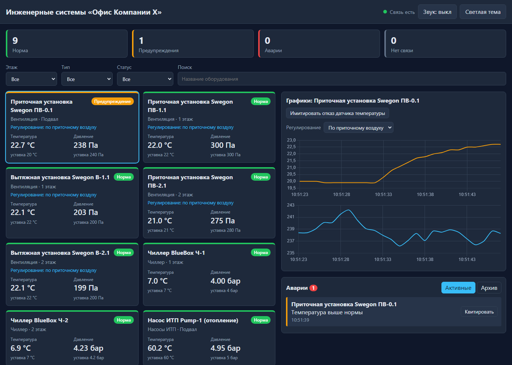

# Инженерные системы «Офис Компании Х»

Веб-дашборд для диспетчера: подвал и два этажа офиса, вентустановки Swegon, чиллеры BlueBox,
насосы ИТП. Данные идут по WebSocket от эмулятора контроллеров (вместо реального Modbus).
Без фреймворков: HTML, CSS, JavaScript и небольшой сервер на Node.js.

**[Открыть демо](https://lynxy-coder.github.io/office-dashboard/)** (работает в браузере без сервера)



## Что умеет

- карточки оборудования со статусом, значениями и уставками
- графики температуры и давления за последние 5 минут
- журнал аварий: квитирование, архив, мигание и звук
- фильтры по этажу, типу, статусу и поиск
- режим регулирования вентустановок: по приточному или по вытяжному воздуху
- имитация отказа датчика температуры
- тёмная и светлая темы
- если сервера нет, работает демо-режим прямо в браузере

## Запуск

Нужен Node.js 18+.

```bash
npm install
npm start
```

Открыть http://localhost:3000. Тесты: `npm test`.

## Демо на GitHub Pages

В репозитории есть workflow, который гоняет тесты и публикует папку `public/`.
Включить один раз: Settings → Pages → Source → GitHub Actions.
